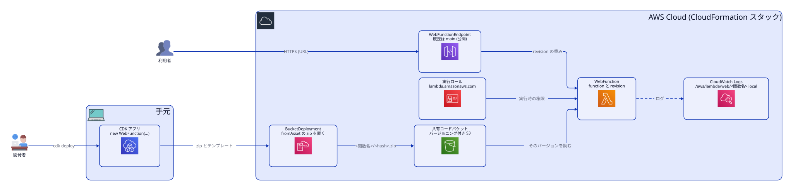

# cdk-lambda-web

Unofficial L2 constructs for [AWS Lambda Web Functions](https://aws.amazon.com/about-aws/whats-new/2026/10/aws-lambda-web-functions/), built on the L1 `Cfn*` resources in aws-cdk-lib.
Not affiliated with AWS. Deployed once to ap-northeast-1 (2026-10-16) with six functions.

AWS Lambda Web Functions 用の自作 L2 コンストラクトです。aws-cdk-lib 2.273.0 にある L1（`CfnWebFunction` / `CfnWebFunctionRevision` / `CfnWebFunctionEndpoint`）を包んでいます。
ap-northeast-1 に 6 関数を実際にデプロイして動作を確認しました（2026-10-16）。

<picture>
  <source media="(prefers-color-scheme: dark)" srcset=".github/architecture/architecture-dark.svg">
  /<hash>.zip に置かれ、WebFunction の revision がそのバージョンを読み、WebFunctionEndpoint の URL から利用者がアクセスする。ログは CloudWatch Logs に出る。">
</picture>

```ts
import { WebFunction, WebFunctionCode, WebFunctionEndpointType, WebFunctionAuthType } from 'cdk-lambda-web';

const fn = new WebFunction(this, 'App', {
  code: WebFunctionCode.fromAsset('dist/app'), // zip → バージョニング付き S3 → そのバージョンを使う
  entrypoint: 'server.mjs',                    // AWS_LAMBDA_NODEJS_ENTRYPOINT（既定は index.js）
  environment: { DATA_API_URL: 'https://...' },
  maxConcurrencyPerEnvironment: 64,            // 1〜128
});
fn.addEnvironment('FOO', 'bar');
bucket.grantRead(fn);                          // 実行ロールに付与
new CfnOutput(this, 'Url', { value: fn.url }); // 既定エンドポイント（公開・HomeRegion）

// 追加のエンドポイント
fn.addEndpoint('Global', {
  endpointType: WebFunctionEndpointType.MULTI_REGION,
  regions: ['ap-northeast-1', 'us-east-1'],
  authType: WebFunctionAuthType.IAM,
  maxEnvironments: 10,
  rateLimit: 500,
});
```

## 提供するもの

| クラス | 内容 |
|---|---|
| `WebFunction` | function・revision・既定エンドポイントをまとめて作成。`role` / `grantPrincipal`（`IGrantable`）、`url`、`addEnvironment`、`addEndpoint`、`addToRolePolicy`。L1 には `cfnFunction` / `cfnRevision` で触れます |
| `WebFunctionEndpoint` | エンドポイント単体。`endpointType`、`authType`、`regions`、`maxEnvironments`、`rateLimit` |
| `WebFunctionCode` | `fromAsset(dir)`（スタックで1つの共有コードバケットに自動アップロード）、`fromBucket(bucket, key, versionId)` |
| `WebFunctionCodeBucket` | 共有コードバケットの取得と、`lambda.amazonaws.com` への読み取り許可 |
| `WebFunctionRuntime` | `NODEJS_24`（`nodejs24.x`）と `of(name)` |

synth 時に検証するもの: `maxConcurrencyPerEnvironment` は 1〜128、`rateLimit` は 0 / 100〜1000（100刻み）/ 2000〜10000（1000刻み）、`regions` は MultiRegion / PerRegion のときだけ必須、revision の重みの合計は 100。

## 実際のデプロイで確かめたこと（ap-northeast-1、2026-10-16）
- 実行ロールの信頼先は `lambda.amazonaws.com`（イベント関数と同じ）で動きました。
- 再デプロイでは revision が置き換わり、エンドポイントは更新だけで作り直されません。URL は変わりません。
- ログはサービスが自動で作るロググループ `/aws/lambda/web/<関数名>.local` に出ます。保持期間は無期限で、スタックを削除しても残ります。保持期間を決めたいときは `logGroup` を渡してください。
- 最初の版の `fromAsset` は revision が接頭辞の無いキー（`<hash>.zip`）を指し、`CreateWebFunctionRevision` が「The specified S3 object does not exist」で失敗していました。今はアップロード先と同じ `<関数名>/<hash>.zip` を指します。

## 未確認の前提
- function 名に使える文字は確認していません（既定はコンストラクトのパスから作る 64 文字以内の一意な名前）。`bench-sveltekit` のような英小文字とハイフンの名前は通りました。
- CDK CLI のローカル検証が `AWS::Lambda::WebFunction` を未知のリソース型として警告しますが、synth は通ります。

## 使い方

npm には公開していません。GitHub から直接入れられます（`prepare` でビルドされます）。

```bash
npm i github:reeschan/cdk-lambda-web
```

ローカルのクローンを使う場合は、シンボリックリンクではなくコピーで入れてください（aws-cdk-lib が二重になるため）。

```bash
npm i --install-links ../path/to/cdk-lambda-web
```

## 開発

```bash
npm ci && npm run typecheck && npm test && npm run build
```

構成図のソースは `.github/architecture/architecture.d2` です。構成を変えたら d2 で描き直し、`architecture-light.svg` / `architecture-dark.svg` を更新してください。

## License

MIT
